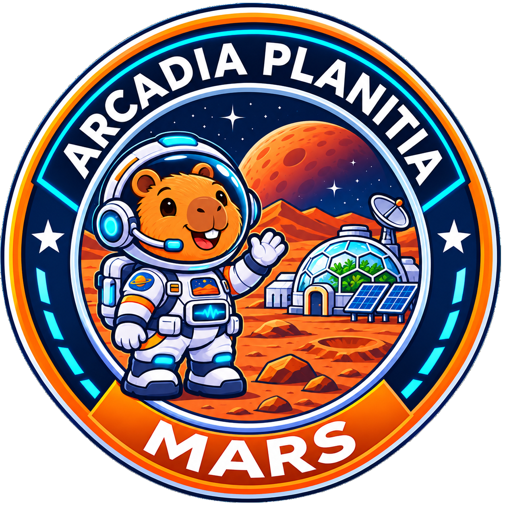

# Mars Adventures

Mars Adventures is a science game for children from 7 to 12 years old. You play an astronaut at Arcadia Planitia, a plain on Mars. Your helper is Capi, a capybara in a space suit. The game reads real space-weather reports from NASA DONKI. DONKI is the NASA database of solar storms.

You choose a boy astronaut or a girl astronaut, and you type a name. The game plays a short flight and then lands on Mars. English is the first language. You can change the language to Brazilian Portuguese on the home screen or on the mission map. The game saves that choice in this browser.

Five missions open in order. Each mission teaches one part of life at the base. The base is the habitat where the astronaut lives.

1. Solar Power. Place the panels so the base gets power from the Sun.
2. Health. Exercise, eat, wash, and sleep so the astronaut stays well.
3. Mars Ice. Drill for ice and turn that ice into water.
4. Greenhouse. Build a dome, plant crops, and close the cycle that gives the base food and oxygen.
5. Storms. Protect the base from dust and from solar radiation.

When you finish a mission, the game shows your meters and saves a photo in the logbook. The logbook is the book of science notes for the trip. When you finish all five missions, you earn a certificate. You can download that certificate as a JPEG file. A JPEG file is a picture file.

Your progress stays in this browser. If you start the game again from the mission map, you lose the missions, the logbook, and the certificate. The language stays.

## Run the game

You need Node.js and pnpm on your computer. Node.js is the program that runs JavaScript tools. pnpm is the tool that installs the packages for this game.

1. Run `pnpm install` in this folder.
2. Run `pnpm dev`.
3. Open `http://localhost:5173` in a browser.

The authors of Mars Adventures are Aline, Joao Guilherme, Jackson, Daniel, Laura, and Julia.
